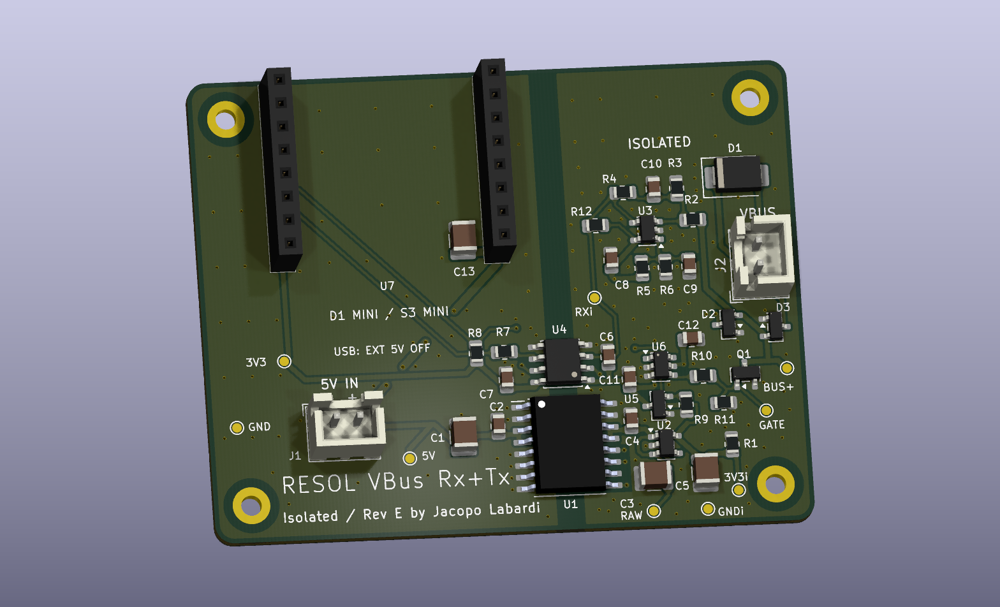
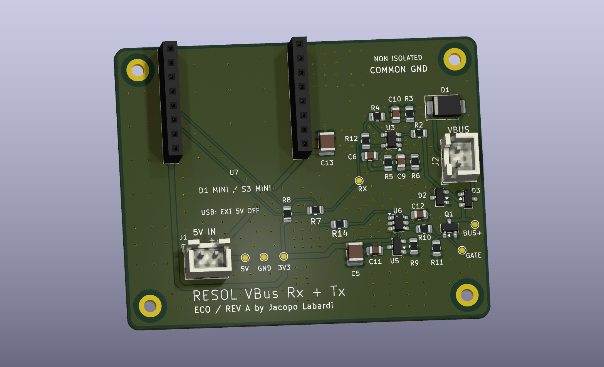
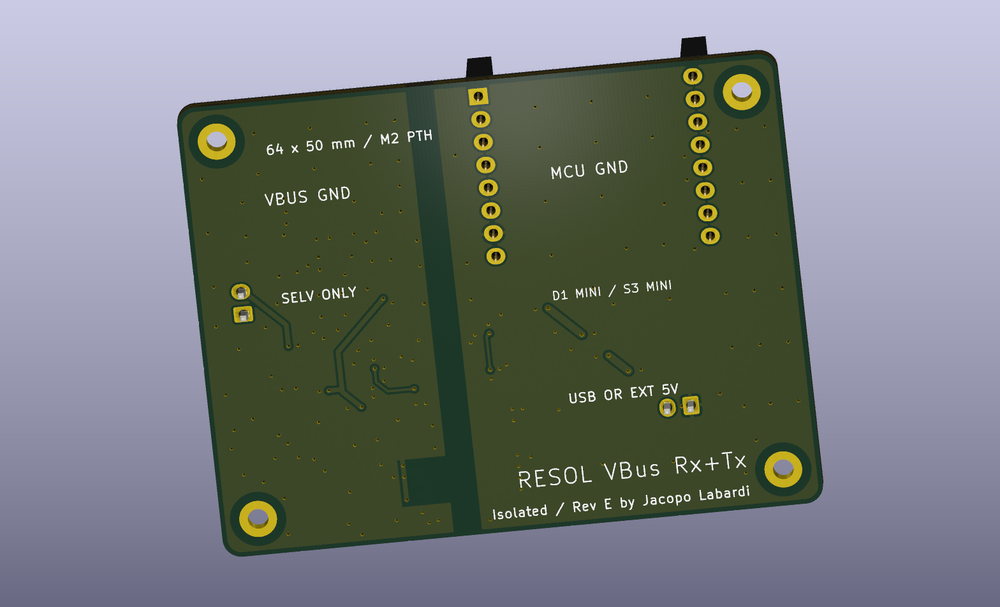
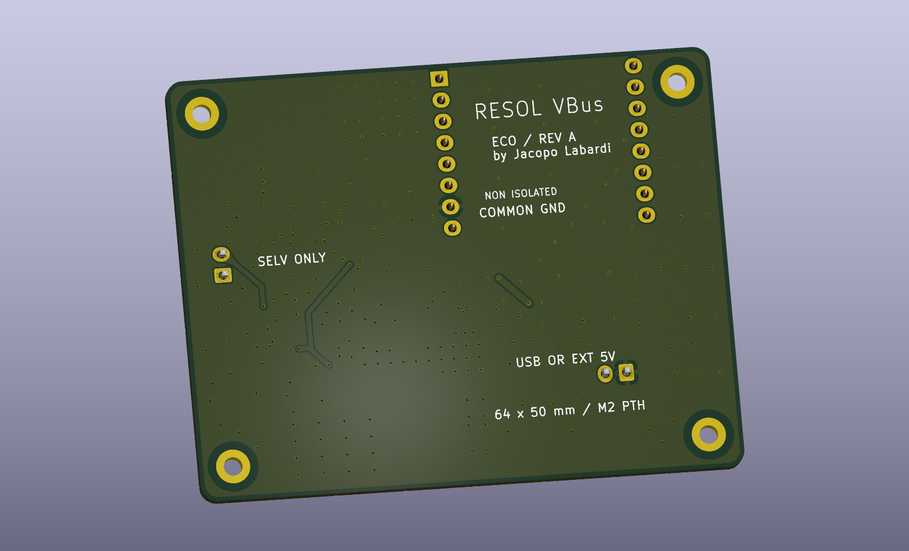
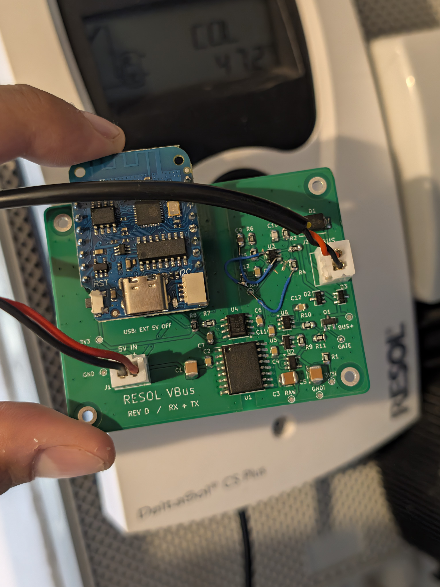

# RESOL VBus interface

I designed this board to connect my **RESOL DeltaSol CS Plus** solar controller to
ESPHome and Home Assistant, with hardware for both receiving and transmitting
VBus messages.

Both versions use a socketed **LOLIN D1 mini or S3 Mini**, a 5 V supply and the same RX/TX firmware pin mapping. Choose the board by how the controller and ESP must be grounded.

| | Isolated (Rev E design files) | ECO Rev A |
|---|---|---|
| Power and UART | RECOM isolated DC/DC, bus-side regulator and digital isolator | Receiver and TX logic run from the module’s 3.3 V rail |
| Grounding | ESP/USB ground is separated from the VBus circuit | USB, J1 ground and the negative output of the VBus bridge are connected |
| Assembly | 35 SMT components | 26 SMT components |
| Test status | An isolated prototype has operated in the field on a DeltaSol CS Plus | CAD checks passed; first assembled-board and field tests are pending |
| KiCad and schematic | [Project](hardware/rev-e/Resol_VBus_RevE.kicad_pro) · [PDF](docs/schematic.pdf) | [Project](hardware/eco-rev-a/RESOL_VBus_ECO_RevA.kicad_pro) · [PDF](hardware/eco-rev-a/RESOL_VBus_ECO_RevA.pdf) |
| Fabrication | [Gerber ZIP](fabrication/Resol_VBus_RevE_Gerbers.zip) · [BOM](fabrication/bom.csv) · [CPL](fabrication/cpl.csv) | [Gerber + stencil ZIP](fabrication/eco-rev-a/RESOL_VBus_ECO_RevA_Gerbers.zip) · [BOM](hardware/eco-rev-a/BOM.csv) · [CPL](fabrication/eco-rev-a/cpl.csv) |

Choose the isolated board when the grounding of the controller or a USB-connected PC is unknown. Choose ECO when a common ground is acceptable. On both boards, power from **J1 or USB, one source at a time**. J1 and J2 use identical connectors; label the power and VBus cables.

| KiCad 3D view | Isolated Rev E | ECO Rev A |
|---|---|---|
| Front |  |  |
| Back |  |  |

The photograph below shows the earlier isolated prototype used in the installation.

## Build notes

- **Isolated:** [prototype release](https://github.com/labodj/resol-vbus-interface/releases/tag/rev-e-prototype-1), [fabrication](docs/fabrication.md), [assembly](docs/assembly.md) and [circuit description](docs/circuit.md).
- **ECO:** [fabrication package and checks](fabrication/eco-rev-a/README.md), [wiring and first power-up](hardware/eco-rev-a/README.md).

## Rev E at a glance

- Two layers, **64 x 50 mm**, with SMD parts on the front.
- Isolated power, RX and TX, independent of the VBus supply level.
- TX stays off during startup and low isolated-supply voltage.
- Replaceable ESP module and accessible test points.
- JST XH **B2B-XH-A, 2.50 mm** connectors for both external power and VBus.
- TS391RIYLT receiver with hysteresis and input filtering.

**J1 is the 5 V input; J2 is VBus.** The connectors are identical, so label the
cables. Use either USB power or external 5 V, **never both at once**. Keep
`GND` and `GND_ISO` separate. This is a low-voltage interface, not a mains input.

## Prototype status

The target controller is a DeltaSol CS Plus running firmware 1.11, with an
approximately 20 cm VBus cable.

Only the isolated design has field experience. The photographed unit is an earlier isolated revision that received a small wiring rework. The [Rev E validation record](docs/validation.md) documents the published CAD revision. ECO Rev A is a separate common-ground prototype awaiting hardware validation.

## Firmware

VBus uses UART at **9600 baud, 8N1, non-inverted**. TX must idle HIGH; driving it
LOW enables the bus sink once the bus-side supervisor releases the TX inhibit. Firmware must wait
for a bus grant before transmitting.

| Module | RX GPIO | TX GPIO | Rev E status |
|---|---:|---:|---|
| LOLIN D1 mini v4.0.0 (ESP8266) | 13 | 12 | Bench testing pending |
| LOLIN S3 Mini v1.0.0 | 11 | 13 | Not yet physically tested |

I am developing the ESPHome TX support separately. This repository contains
the hardware, not a ready-to-flash firmware image. It does not imply that the
standard ESPHome VBus component already supports transmitting settings.

## Editing the design

Install KiCad 10 or newer with its standard libraries and open the `.kicad_pro`
file. Project libraries use relative paths. The optional RECOM 3D model is not
included; a missing model affects the 3D view only. See [third-party notices](THIRD_PARTY.md).

The [maintenance notes](docs/manual-review.md) explain test-point exclusions
and the checks to run after changes.

## Citation

If you use this design in a publication, cite it using the [project citation metadata](CITATION.cff). Include the board revision so readers can identify the circuit you used.

## Background and license

My original design drew on the [ESPHome VBus documentation](https://esphome.io/components/vbus/)
and [FatBeard's VBus PCB project](https://github.com/FatBeard/vbus-arduino-library/tree/master/pcb).
This is an independent project, without endorsement by RESOL, ESPHome or LOLIN.
Their names and trademarks remain theirs.

Original hardware: **CERN-OHL-P-2.0**; documentation: **CC-BY-4.0**; scripts:
**MIT**. KiCad library data retains **CC-BY-SA-4.0 with the KiCad library exception**.
See [LICENSE.md](LICENSE.md) and [third-party notices](THIRD_PARTY.md).
