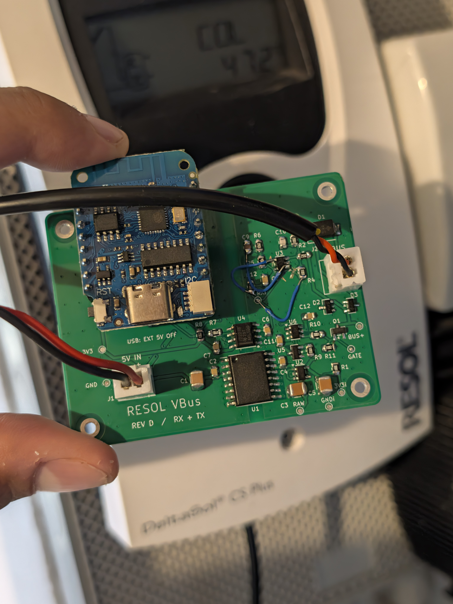
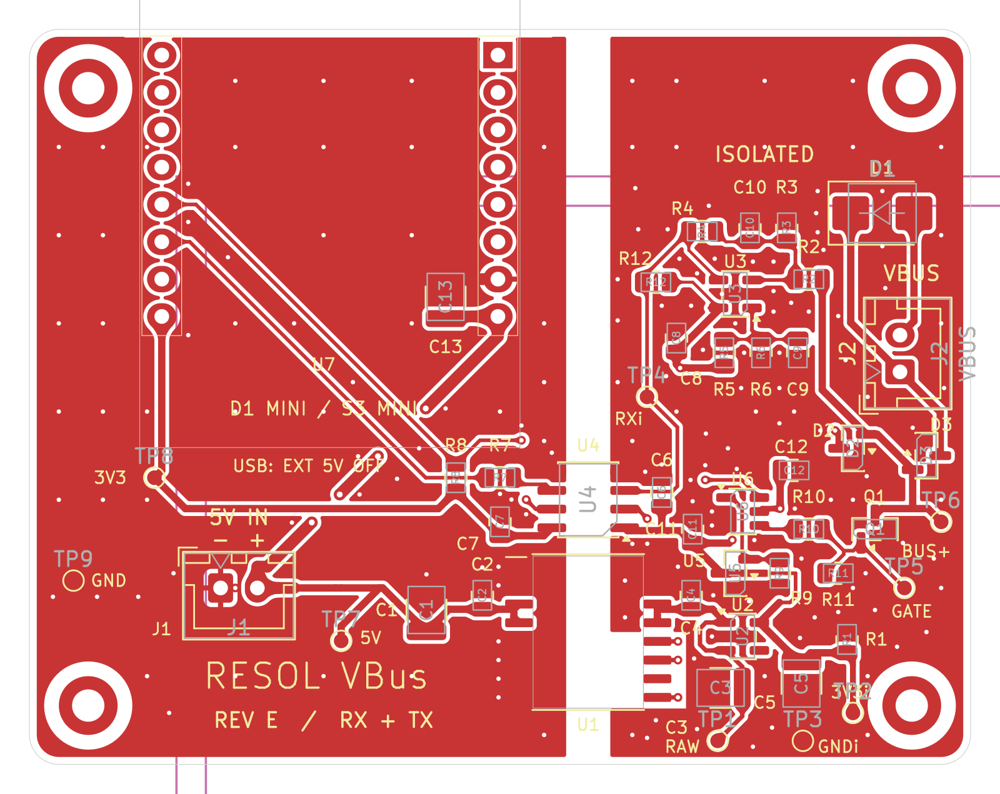

# Isolated RESOL VBus interface

I designed this board to connect my **RESOL DeltaSol CS Plus** solar controller to
ESPHome and Home Assistant, with hardware for both receiving and transmitting
VBus messages.

The board takes a socketed **LOLIN D1 mini** or **LOLIN S3 Mini** and runs from
5 V. An isolated DC/DC converter and digital isolator keep the VBus side
electrically separate from the ESP and its USB connection.

*My assembled prototype connected to the solar controller. This is an earlier
revision that needed a small wiring rework; the published design files are Rev E.*

## Get started

- **Build a board:** download the [Rev E prototype release](https://github.com/labodj/resol-vbus-interface/releases/tag/rev-e-prototype-1), then read the [fabrication notes](docs/fabrication.md) and [assembly guide](docs/assembly.md).
- **Explore the design:** open the [KiCad 10 project](hardware/rev-e/Resol_VBus_RevE.kicad_pro) or view the [schematic PDF](docs/schematic.pdf).
- **Understand the circuit:** see [how it works](docs/circuit.md).
- **Check the parts:** use the [BOM for one board](fabrication/bom.csv) and [SMT placement file](fabrication/cpl.csv).

## Rev E at a glance

- Two layers, **64 x 50 mm**, with SMD parts on the front.
- Isolated power, RX and TX, independent of the VBus supply level.
- TX stays off during startup and low isolated-supply voltage.
- Replaceable ESP module and accessible test points.
- JST XH **B2B-XH-A, 2.50 mm** connectors for both external power and VBus.
- TS391RIYLT receiver with hysteresis and input filtering.

**J1 is the 5 V input; J2 is VBus.** The connectors are identical, so label the
cables. Use either USB power or external 5 V, **never both at once**. Keep
`GND` and `GND_ISO` separate. This is a low-voltage interface, not a mains input.

## Prototype status

The target controller is a DeltaSol CS Plus running firmware 1.11, with an
approximately 20 cm VBus cable.

**Rev E is a prototype:** its CAD checks pass, but I have not yet assembled or
bench-tested this revision. Other controllers, longer cables and the S3 Mini
need their own tests. See [validation](docs/validation.md) for the checks and
remaining limits. The Rev E layout below is a CAD view.

## Firmware

VBus uses UART at **9600 baud, 8N1, non-inverted**. TX must idle HIGH; driving it
LOW enables the bus sink when the isolated supply is ready. Firmware must wait
for a bus grant before transmitting.

| Module | RX GPIO | TX GPIO | Rev E status |
|---|---:|---:|---|
| LOLIN D1 mini v4.0.0 (ESP8266) | 13 | 12 | Bench testing pending |
| LOLIN S3 Mini v1.0.0 | 11 | 13 | Not yet physically tested |

I am developing the ESPHome TX support separately. This repository contains
the hardware, not a ready-to-flash firmware image. It does not imply that the
standard ESPHome VBus component already supports transmitting settings.

## Rev E layout

## Editing the design

Install KiCad 10 or newer with its standard libraries and open the `.kicad_pro`
file. Project libraries use relative paths. The optional RECOM 3D model is not
included; a missing model affects the 3D view only. See [third-party notices](THIRD_PARTY.md).

The [maintenance notes](docs/manual-review.md) explain test-point exclusions
and the checks to run after changes.

## Background and license

My original design drew on the [ESPHome VBus documentation](https://esphome.io/components/vbus/)
and [FatBeard's VBus PCB project](https://github.com/FatBeard/vbus-arduino-library/tree/master/pcb).
This is an independent project, without endorsement by RESOL, ESPHome or LOLIN.
Their names and trademarks remain theirs.

Original hardware: **CERN-OHL-P-2.0**; documentation: **CC-BY-4.0**; scripts:
**MIT**. KiCad library data retains **CC-BY-SA-4.0 with the KiCad library exception**.
See [LICENSE.md](LICENSE.md) and [third-party notices](THIRD_PARTY.md).
