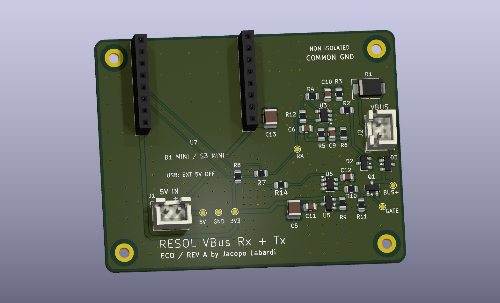
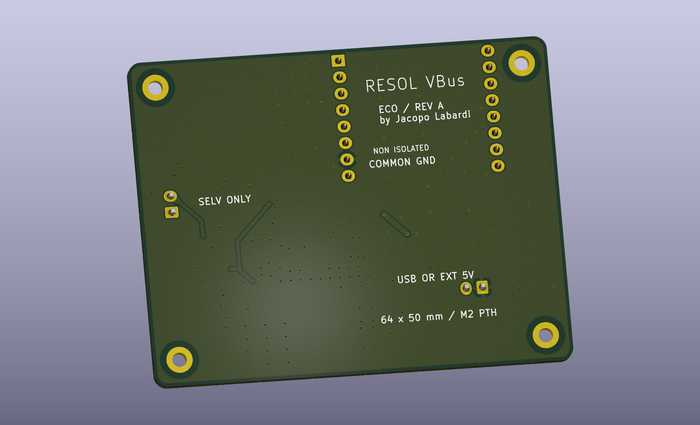

# RESOL VBus ECO Rev A

Dedicated, non-isolated VBus RX/TX interface derived from the Rev F ECO circuit. Open [the KiCad project](RESOL_VBus_ECO_RevA.kicad_pro) to work on this board. The isolated interface has its own [Rev E project](../rev-e/Resol_VBus_RevE.kicad_pro).

Only the isolated prototype has been tested in the field. ECO Rev A has passed electrical and layout checks in KiCad; operation with a physical controller still needs verification.

| Front | Back |
|---|---|
|  |  |

[Fabrication ZIP, stencil layer and SMT placement file](../../fabrication/eco-rev-a/README.md)

## Interfaces

| Interface | Pin or setting |
|---|---|
| J1 supply | Pin 1 GND, pin 2 +5 V |
| J2 VBus | Pin 1 VBUS_B, pin 2 VBUS_A |
| LOLIN D1 mini v4 | RX GPIO13, TX GPIO12 |
| LOLIN S3 Mini v1 | RX GPIO11, TX GPIO13 |
| UART | 9600 baud, 8N1, non-inverted, TX idle HIGH |

Power the board from either J1 or the module USB connector, one at a time. The module's 3.3 V output supplies the receiver and transmit logic. The MAX809 supervisor and the logic gate inhibit the bus sink during startup and undervoltage. Firmware must still wait for a bus grant before driving TX.

The bridge negative, module ground, J1 ground and USB ground are common. Check the controller and USB grounding before combining them. Use a floating supply for initial VBus testing. The isolated Rev E is the appropriate choice when the installation's grounding is unknown.

## First prototype

Confirm the socket orientation before fitting the module. Check for a supply short with power removed. First power from a current-limited 5 V supply, with USB and VBus disconnected. Measure +5 V at TP7 and module 3.3 V at TP8, using TP9 as ground. Check supervisor release and confirm that TP5 (the sink MOSFET gate) stays near 0 V at idle before connecting to a controller. TP4 monitors the comparator output, and TP6 monitors the rectified VBus voltage. Verify reception before enabling transmission. Physical qualification of the dedicated ECO board is pending.

## CAD verification

The [schematic PDF](RESOL_VBus_ECO_RevA.pdf) and [assembly BOM](BOM.csv) correspond to the dedicated design. The BOM has 29 fitted references, including the selectable module U7. Its two physical socket strips are part of the module mounting arrangement. Six copper test pads and four mechanical holes are omitted from the parts order.

The prototype layout uses the original 64 × 50 mm outline, mounting holes and connectors. Both 35 µm copper layers have common ground, with the module antenna and mounting exclusions retained. The RX series resistor R7 is 1.10 kΩ (0805), equal to the original 1 kΩ and 100 Ω in series. The TX series resistor R14 remains 1 kΩ. The saved schematic was checked against the simplified ECO circuit across all 26 nets and 89 pin endpoints. ERC and board DRC including zone refill and schematic parity passed in KiCad 10.0.8. Repeat both checks after manual edits.
