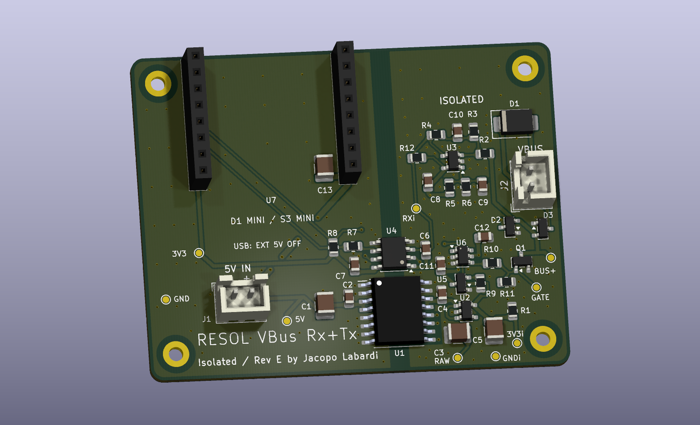
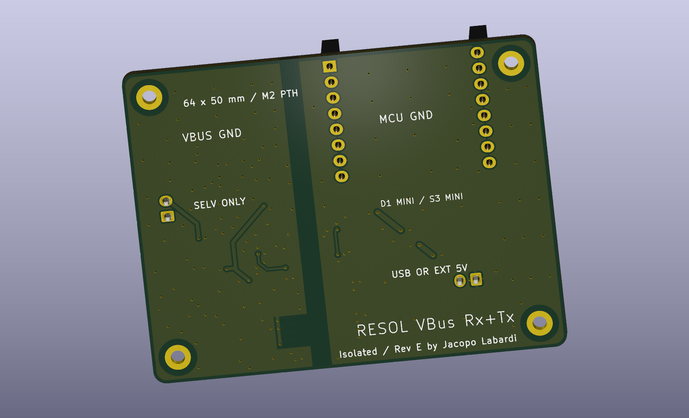

# RESOL VBus isolated interface, Rev E

The RECOM converter and the UART isolator separate the controller-side circuit from the ESP supply and USB ground. Both external 5 V and USB can power the interface. Use one source at a time.

Only the isolated design has been tested in the field on a DeltaSol CS Plus. The installation used an earlier isolated prototype with a wiring rework. The published Rev E files have their own [CAD validation record](../../docs/validation.md).

| Front | Back |
|---|---|
|  |  |

[KiCad project](Resol_VBus_RevE.kicad_pro) · [Schematic](../../docs/schematic.pdf) · [Fabrication files](../../docs/fabrication.md) · [Assembly guide](../../docs/assembly.md)

The [ECO Rev A](../eco-rev-a/README.md) uses the module’s 3.3 V supply and a shared ground. It has its own fabrication package and is awaiting hardware testing.
